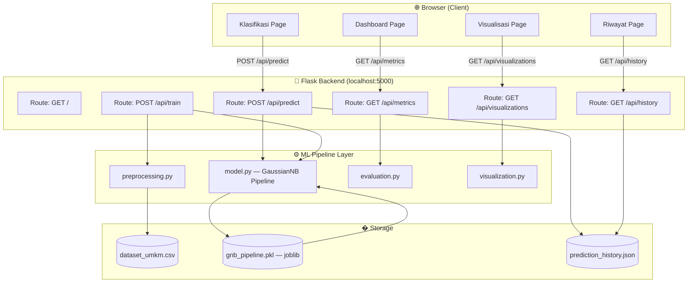
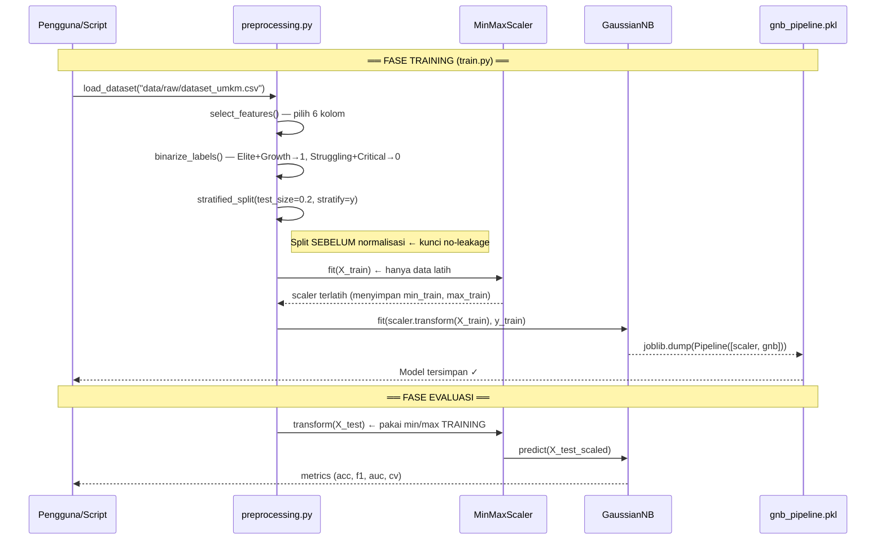
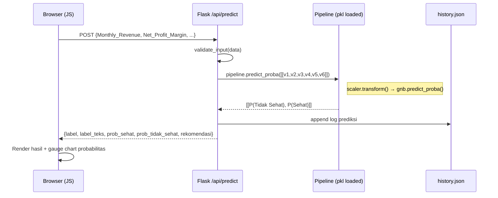

# Dokumen Desain: Sistem Klasifikasi Kondisi Keuangan UMKM

## Overview

Sistem ini adalah aplikasi web berbasis **Flask** (Python) yang mengimplementasikan **Gaussian Naïve Bayes** untuk mengklasifikasikan kondisi keuangan UMKM menjadi dua kategori: **Sehat** atau **Tidak Sehat**. Sistem dibangun sebagai penelitian skripsi menggunakan dataset sintetis 150.000 data dari Kaggle dengan 6 fitur keuangan utama, pipeline scikit-learn yang bebas data leakage, dan antarmuka web HTML/CSS/JavaScript yang ramah pengguna UMKM.

Pipeline ML menerapkan pemisahan data (stratified 80:20) **sebelum** normalisasi, sehingga MinMaxScaler hanya di-fit pada data latih dan ditransformasikan ke data uji — menjamin tidak ada informasi dari test set yang bocor ke proses training. Model yang telah dilatih (Accuracy 94,70%, F1 94,72%, ROC-AUC 0,9859) disimpan via joblib dan dimuat saat inferensi.

Antarmuka menyediakan empat halaman utama: Dashboard (ringkasan metrik), Klasifikasi (form input dan prediksi real-time), Visualisasi (EDA, confusion matrix, ROC curve, feature importance), dan Riwayat Prediksi (log prediksi tersimpan di JSON/SQLite lokal). Backend Flask melayani REST API yang dikonsumsi frontend JavaScript secara asinkron.

---

## Architecture

### Diagram Arsitektur High-Level



### Diagram Alur Data — Training Pipeline



### Diagram Alur Data — Inferensi Real-time



---

## Struktur Direktori Proyek

```
umkm-financial-classifier/
│
├── app.py                          # Entry point Flask application
├── train.py                        # Script training pipeline (jalankan sekali)
├── requirements.txt
├── README.md
│
├── data/
│   ├── raw/
│   │   └── dataset_umkm.csv        # Dataset 150.000 baris dari Kaggle
│   └── processed/
│       └── dataset_clean.csv       # Dataset setelah preprocessing
│
├── models/
│   └── gnb_pipeline.pkl            # Sklearn Pipeline (scaler + GNB) tersimpan
│
├── src/
│   ├── __init__.py
│   ├── preprocessing.py            # Load, seleksi fitur, split, validasi
│   ├── model.py                    # Build, train, save, load, predict
│   ├── evaluation.py               # Metrics, confusion matrix, ROC, CV
│   └── visualization.py            # Plot functions (matplotlib/seaborn → base64)
│
├── static/
│   ├── css/
│   │   └── style.css               # Styling utama
│   ├── js/
│   │   ├── dashboard.js            # Logic halaman dashboard
│   │   ├── klasifikasi.js          # Logic form prediksi
│   │   ├── visualisasi.js          # Logic halaman visualisasi
│   │   └── riwayat.js              # Logic halaman riwayat
│   └── img/
│       └── logo.png
│
├── templates/
│   ├── base.html                   # Layout dasar dengan navbar
│   ├── dashboard.html
│   ├── klasifikasi.html
│   ├── visualisasi.html
│   └── riwayat.html
│
├── data/
│   └── prediction_history.json     # Log riwayat prediksi
│
└── tests/
    ├── test_preprocessing.py
    ├── test_model.py
    ├── test_evaluation.py
    └── test_pbt.py                 # Property-based tests (Hypothesis)
```

---

## Components and Interfaces

### Komponen 1: Preprocessor (`src/preprocessing.py`)

**Tujuan**: Memuat dataset, menyeleksi 6 fitur, binarisasi label, split stratified, dan validasi input.

**Antarmuka**:

```python
# Konstanta global
FITUR_TERPILIH: list[str] = [
    "Monthly_Revenue",
    "Net_Profit_Margin",
    "Burn_Rate_Ratio",
    "Transaction_Count",
    "Repeat_Order_Rate",
    "Business_Tenure_Months",
]
LABEL_KOLOM: str = "Financial_Condition"
LABEL_MAP: dict = {"Elite": 1, "Growth": 1, "Struggling": 0, "Critical": 0}

BATAS_VALIDASI: dict = {
    "Monthly_Revenue":        {"min": 0.01,  "max": float("inf"), "tipe": float},
    "Net_Profit_Margin":      {"min": -35.0, "max": 45.0,        "tipe": float},
    "Burn_Rate_Ratio":        {"min": 0.44,  "max": 1.55,        "tipe": float},
    "Transaction_Count":      {"min": 9,     "max": 285,         "tipe": int},
    "Repeat_Order_Rate":      {"min": 2.0,   "max": 54.0,        "tipe": float},
    "Business_Tenure_Months": {"min": 3,     "max": 179,         "tipe": int},
}

def load_dataset(path: str) -> pd.DataFrame:
    """Muat dataset dari CSV. Raise FileNotFoundError jika tidak ada."""

def select_features(df: pd.DataFrame) -> tuple[pd.DataFrame, pd.Series]:
    """Pilih FITUR_TERPILIH sebagai X dan binarisasi LABEL_KOLOM sebagai y."""

def split_data(
    X: pd.DataFrame,
    y: pd.Series,
    test_size: float = 0.2,
    random_state: int = 42,
) -> tuple[pd.DataFrame, pd.DataFrame, pd.Series, pd.Series]:
    """Stratified train-test split. Dipanggil SEBELUM normalisasi."""

def validate_input(data: dict) -> tuple[bool, list[str]]:
    """
    Validasi dict input dari form/API.
    Return: (is_valid, list_pesan_error)
    """

def validate_csv_columns(df: pd.DataFrame) -> tuple[bool, list[str]]:
    """Pastikan df memiliki semua kolom FITUR_TERPILIH."""
```

**Tanggung Jawab**:
- Memastikan split dilakukan **sebelum** normalisasi (mencegah data leakage)
- Memetakan 4 kelas asli ke biner (1/0)
- Memvalidasi semua input user sebelum diteruskan ke model

---

### Komponen 2: Model (`src/model.py`)

**Tujuan**: Membangun, melatih, menyimpan, memuat, dan menjalankan inferensi GaussianNB Pipeline.

**Antarmuka**:

```python
def build_pipeline() -> Pipeline:
    """
    Buat sklearn Pipeline:
      Step 1: MinMaxScaler()  — normalisasi ke [0, 1]
      Step 2: GaussianNB()    — classifier
    Pipeline menjamin scaler hanya di-fit sekali pada data latih.
    """

def train_pipeline(
    X_train: pd.DataFrame,
    y_train: pd.Series,
) -> Pipeline:
    """
    Fit pipeline pada data latih.
    MinMaxScaler.fit() hanya menggunakan X_train.
    """

def save_pipeline(pipeline: Pipeline, path: str = "models/gnb_pipeline.pkl") -> None:
    """Simpan Pipeline ke .pkl menggunakan joblib.dump()."""

def load_pipeline(path: str = "models/gnb_pipeline.pkl") -> Pipeline:
    """Muat Pipeline dari .pkl menggunakan joblib.load()."""

def predict_single(pipeline: Pipeline, input_dict: dict) -> dict:
    """
    Prediksi satu sampel.
    Return: {label, label_teks, prob_sehat, prob_tidak_sehat, rekomendasi}
    """

def predict_dataframe(pipeline: Pipeline, df: pd.DataFrame) -> pd.DataFrame:
    """
    Prediksi seluruh baris DataFrame.
    Menambahkan kolom: Prediksi_Label, Prediksi_Teks,
    Prob_Sehat, Prob_Tidak_Sehat.
    """
```

---

### Komponen 3: Evaluator (`src/evaluation.py`)

**Tujuan**: Menghitung semua metrik evaluasi dan cross-validation.

```python
def compute_metrics(
    y_true: np.ndarray,
    y_pred: np.ndarray,
    y_proba: np.ndarray,
) -> dict:
    """
    Hitung: accuracy, precision, recall, f1_weighted, roc_auc.
    Semua nilai dalam [0.0, 1.0].
    """

def compute_confusion_matrix(
    y_true: np.ndarray,
    y_pred: np.ndarray,
) -> np.ndarray:
    """Return confusion matrix shape (2, 2): [[TN, FP], [FN, TP]]."""

def compute_roc_curve(
    y_true: np.ndarray,
    y_proba_pos: np.ndarray,  # probabilitas kelas positif (Sehat)
) -> tuple[np.ndarray, np.ndarray, float]:
    """Return (fpr_array, tpr_array, auc_score)."""

def cross_validate(
    X: pd.DataFrame,
    y: pd.Series,
    n_splits: int = 10,
    random_state: int = 42,
) -> dict:
    """
    10-Fold Stratified CV pada data latih saja.
    Return: {mean_acc, std_acc, scores_per_fold, mean_f1, std_f1}
    """
```

---

### Komponen 4: Visualizer (`src/visualization.py`)

**Tujuan**: Menghasilkan plot matplotlib/seaborn, dikembalikan sebagai string Base64 PNG ke frontend.

```python
def plot_class_distribution(y: pd.Series) -> str:
    """Pie chart distribusi Sehat vs Tidak Sehat → base64 PNG."""

def plot_correlation_heatmap(X: pd.DataFrame) -> str:
    """Heatmap korelasi 6 fitur → base64 PNG."""

def plot_kde_per_feature(X: pd.DataFrame, y: pd.Series) -> str:
    """KDE plot per fitur, dipisah per kelas → base64 PNG."""

def plot_confusion_matrix(cm: np.ndarray) -> str:
    """Confusion matrix heatmap dengan label TP/TN/FP/FN → base64 PNG."""

def plot_roc_curve(fpr: np.ndarray, tpr: np.ndarray, auc: float) -> str:
    """ROC Curve dengan nilai AUC di legenda → base64 PNG."""

def plot_feature_importance(pipeline: Pipeline) -> str:
    """
    Bar chart 'feature importance' GaussianNB berdasarkan
    selisih mean antar kelas dinormalisasi oleh variansi
    (proxy importance karena GNB tidak punya feature_importances_).
    → base64 PNG
    """

def plot_cross_val_scores(scores: np.ndarray) -> str:
    """Bar chart akurasi tiap fold CV → base64 PNG."""

def fig_to_base64(fig: plt.Figure) -> str:
    """Helper: konversi matplotlib Figure ke data URL base64."""
```

---

### Komponen 5: Flask Application (`app.py`)

**Tujuan**: Melayani halaman HTML dan REST API endpoint.

```python
# REST API Endpoints

@app.route("/")
def index(): ...
# Redirect ke /dashboard

@app.route("/dashboard")
def dashboard(): ...
# Render templates/dashboard.html

@app.route("/klasifikasi")
def klasifikasi(): ...
# Render templates/klasifikasi.html

@app.route("/visualisasi")
def visualisasi(): ...
# Render templates/visualisasi.html

@app.route("/riwayat")
def riwayat(): ...
# Render templates/riwayat.html

@app.route("/api/predict", methods=["POST"])
def api_predict():
    """
    Terima JSON body dengan 6 fitur.
    Return JSON: {success, label, label_teks, prob_sehat,
                  prob_tidak_sehat, rekomendasi, timestamp}
    """

@app.route("/api/metrics", methods=["GET"])
def api_metrics():
    """
    Return JSON: {accuracy, precision, recall, f1, roc_auc,
                  cv_mean_acc, cv_std_acc, total_train, total_test}
    """

@app.route("/api/visualizations", methods=["GET"])
def api_visualizations():
    """
    Return JSON: {class_dist, correlation, kde, confusion_matrix,
                  roc_curve, feature_importance, cv_scores}
    Semua nilai adalah string base64 PNG data URL.
    """

@app.route("/api/history", methods=["GET"])
def api_history():
    """
    Return JSON: {predictions: [...], total: int}
    """

@app.route("/api/train", methods=["POST"])
def api_train():
    """
    Trigger ulang training pipeline.
    Return JSON: {success, metrics, training_time_seconds}
    """
```

---

## Data Models

### Model Input Prediksi

```python
@dataclass
class InputKeuangan:
    Monthly_Revenue: float          # Pendapatan bulanan (juta Rp), > 0
    Net_Profit_Margin: float        # Margin laba bersih (%), -35.0 s.d. 45.0
    Burn_Rate_Ratio: float          # Rasio bakar uang, 0.44 s.d. 1.55
    Transaction_Count: int          # Jumlah transaksi/bulan, 9 s.d. 285
    Repeat_Order_Rate: float        # Tingkat repeat order (%), 2.0 s.d. 54.0
    Business_Tenure_Months: int     # Lama usaha (bulan), 3 s.d. 179
```

### Tabel Validasi Input

| Fitur | Tipe | Min | Max | Unit |
|---|---|---|---|---|
| `Monthly_Revenue` | float | 0.01 | ∞ | Juta Rupiah |
| `Net_Profit_Margin` | float | -35.0 | 45.0 | % |
| `Burn_Rate_Ratio` | float | 0.44 | 1.55 | Rasio |
| `Transaction_Count` | int | 9 | 285 | Transaksi/bulan |
| `Repeat_Order_Rate` | float | 2.0 | 54.0 | % |
| `Business_Tenure_Months` | int | 3 | 179 | Bulan |

### Model Output Prediksi

```python
@dataclass
class OutputPrediksi:
    label: int                      # 0 = Tidak Sehat, 1 = Sehat
    label_teks: str                 # "Sehat" atau "Tidak Sehat"
    prob_sehat: float               # P(Sehat|X) ∈ [0.0, 1.0]
    prob_tidak_sehat: float         # P(Tidak Sehat|X) ∈ [0.0, 1.0]
    rekomendasi: str                # Teks rekomendasi kontekstual
    timestamp: str                  # ISO 8601 timestamp
```

### Model Riwayat Prediksi (prediction_history.json)

```python
# Setiap entri dalam list
{
    "id": "uuid-v4",
    "timestamp": "2024-01-15T10:30:00",
    "input": {
        "Monthly_Revenue": 45.5,
        "Net_Profit_Margin": 12.3,
        "Burn_Rate_Ratio": 0.78,
        "Transaction_Count": 120,
        "Repeat_Order_Rate": 35.0,
        "Business_Tenure_Months": 24
    },
    "output": {
        "label": 1,
        "label_teks": "Sehat",
        "prob_sehat": 0.8743,
        "prob_tidak_sehat": 0.1257,
        "rekomendasi": "..."
    }
}
```

---

## Pseudocode Algoritmik & Spesifikasi Formal

### Algoritma 1: Pipeline Preprocessing (Tanpa Data Leakage)

```pascal
ALGORITHM preprocess_no_leakage(dataset_path)
INPUT:  dataset_path: str
OUTPUT: X_train, X_test, y_train, y_test

PRECONDITIONS:
  - File CSV ada dan terbaca
  - Kolom FITUR_TERPILIH + "Financial_Condition" ada di dataset
  - Financial_Condition ∈ {Elite, Growth, Struggling, Critical}

POSTCONDITIONS:
  - len(X_train) == 120000, len(X_test) == 30000
  - y_train, y_test ⊆ {0, 1}
  - |mean(y_train) - mean(y_test)| < 0.01   (stratifikasi terjaga)
  - MinMaxScaler BELUM di-fit pada titik ini
  - X_test TIDAK memengaruhi langkah apapun sebelumnya

BEGIN
  df ← pd.read_csv(dataset_path)
  ASSERT len(df) == 150000

  X ← df[FITUR_TERPILIH]
  y ← df["Financial_Condition"].map(LABEL_MAP)
  ASSERT y.isnull().sum() == 0

  # LANGKAH KRITIS: Split SEBELUM normalisasi
  X_train, X_test, y_train, y_test ← stratified_split(
      X, y, test_size=0.2, stratify=y, random_state=42
  )

  # Scaler TIDAK di-fit di sini — diserahkan ke build_pipeline()
  RETURN X_train, X_test, y_train, y_test
END
```

---

### Algoritma 2: Build & Train Pipeline

```pascal
ALGORITHM train_gnb_pipeline(X_train, y_train)
INPUT:  X_train: DataFrame(120000, 6)
        y_train: Series(120000,)
OUTPUT: pipeline: sklearn.Pipeline terlatih

PRECONDITIONS:
  - X_train tidak mengandung NaN
  - y_train ⊆ {0, 1}
  - len(X_train) == len(y_train)

POSTCONDITIONS:
  - pipeline.named_steps["scaler"].data_min_.shape == (6,)
  - pipeline.named_steps["scaler"].data_max_.shape == (6,)
  - pipeline.named_steps["gnb"].theta_.shape == (2, 6)
  - pipeline.named_steps["gnb"].var_.shape == (2, 6)
  - Semua data_min_ dan data_max_ berasal HANYA dari X_train

BEGIN
  pipeline ← Pipeline([
      ("scaler", MinMaxScaler()),
      ("gnb", GaussianNB())
  ])

  # pipeline.fit() secara internal:
  # 1. scaler.fit_transform(X_train)  → X_train_scaled
  # 2. gnb.fit(X_train_scaled, y_train)
  pipeline.fit(X_train, y_train)

  ASSERT pipeline.named_steps["scaler"].data_min_ IS NOT NULL
  ASSERT pipeline.named_steps["gnb"].theta_.shape == (2, 6)

  RETURN pipeline
END
```

---

### Algoritma 3: Formula Gaussian Naïve Bayes (Inti Matematis)

```pascal
ALGORITHM gaussian_naive_bayes_predict(pipeline, X_new)
INPUT:  pipeline: Pipeline terlatih
        X_new: array(n, 6)
OUTPUT: proba: array(n, 2)  -- [[P(0|x), P(1|x)], ...]

PRECONDITIONS:
  - pipeline sudah di-fit
  - X_new.shape[1] == 6
  - Tidak ada NaN atau Inf dalam X_new

POSTCONDITIONS:
  - proba.shape == (n, 2)
  - ∀ i: proba[i][0] + proba[i][1] == 1.0 ± 1e-6
  - ∀ i,j: proba[i][j] ∈ [0.0, 1.0]

BEGIN
  scaler ← pipeline.named_steps["scaler"]
  gnb    ← pipeline.named_steps["gnb"]

  # Langkah 1: Normalisasi Min-Max (menggunakan min/max dari X_train)
  # Formula: x_scaled = (x - x_min_train) / (x_max_train - x_min_train)
  X_scaled ← scaler.transform(X_new)

  # Langkah 2: Hitung log-posterior untuk setiap kelas
  FOR EACH sampel x IN X_scaled:
    FOR EACH kelas c IN {0, 1}:
      log_posterior_c ← log(gnb.class_prior_[c])   # log P(y=c)

      FOR EACH fitur i IN {0..5}:
        μ_ci  ← gnb.theta_[c][i]      # rata-rata fitur i kelas c
        σ²_ci ← gnb.var_[c][i]        # variansi fitur i kelas c

        # Formula PDF Gaussian:
        # P(x_i | y=c) = (1/√(2π·σ²)) · exp(-(x_i - μ)²/(2σ²))
        # Dalam log-space:
        log_lik_ci ← -0.5·log(2π·σ²_ci) - ((x[i] - μ_ci)² / (2·σ²_ci))

        log_posterior_c ← log_posterior_c + log_lik_ci
      END FOR

      log_posteriors[c] ← log_posterior_c
    END FOR

    # Langkah 3: Normalisasi → probabilitas (log-sum-exp trick)
    proba[x_idx] ← softmax(log_posteriors)
  END FOR

  ASSERT ∀ i: |proba[i].sum() - 1.0| < 1e-6
  RETURN proba
END

LOOP INVARIANT (loop fitur):
  Setelah iterasi ke-i: log_posterior_c menyertakan kontribusi fitur 0..i
  dan semua penambahan sebelumnya tetap valid.
```

---

### Algoritma 4: Stratified Cross-Validation 10-Fold

```pascal
ALGORITHM cross_validate_train_only(X_train, y_train, n_splits=10)
INPUT:  X_train: DataFrame(120000, 6)  -- HANYA data latih
        y_train: Series(120000,)
        n_splits: int = 10
OUTPUT: cv_results: dict

PRECONDITIONS:
  - X_train dan y_train berasal dari split sebelumnya (tidak termasuk X_test)
  - n_splits >= 2
  - y_train ⊆ {0, 1}

POSTCONDITIONS:
  - len(cv_results["scores"]) == n_splits
  - cv_results["mean_acc"] ≈ 0.9502 ± 0.002
  - Setiap fold mempertahankan proporsi kelas dalam y_train

BEGIN
  skf ← StratifiedKFold(n_splits=10, shuffle=True, random_state=42)
  acc_scores ← []
  f1_scores  ← []

  fold ← 1
  FOR EACH (train_idx, val_idx) IN skf.split(X_train, y_train):
    # LOOP INVARIANT: len(acc_scores) == fold - 1
    # Semua fold sebelumnya telah dievaluasi dengan pipeline terpisah

    Xf_train ← X_train.iloc[train_idx]
    Xf_val   ← X_train.iloc[val_idx]
    yf_train ← y_train.iloc[train_idx]
    yf_val   ← y_train.iloc[val_idx]

    # Pipeline baru per fold — cegah leakage antar fold
    fold_pipe ← Pipeline([("scaler", MinMaxScaler()), ("gnb", GaussianNB())])
    fold_pipe.fit(Xf_train, yf_train)

    y_pred ← fold_pipe.predict(Xf_val)
    acc_scores.append(accuracy_score(yf_val, y_pred))
    f1_scores.append(f1_score(yf_val, y_pred, average="weighted"))
    fold ← fold + 1
  END FOR

  ASSERT len(acc_scores) == n_splits

  RETURN {
      "scores":   acc_scores,
      "mean_acc": mean(acc_scores),
      "std_acc":  std(acc_scores),
      "mean_f1":  mean(f1_scores),
      "std_f1":   std(f1_scores),
  }
END
```

---

### Algoritma 5: Prediksi Manual via API

```pascal
ALGORITHM api_predict_handler(request_json)
INPUT:  request_json: dict  -- dari POST /api/predict
OUTPUT: response_json: dict

PRECONDITIONS:
  - gnb_pipeline.pkl ada dan dapat dimuat
  - request_json memiliki tepat 6 kunci sesuai FITUR_TERPILIH

POSTCONDITIONS:
  - response_json["label"] ∈ {0, 1}
  - response_json["prob_sehat"] + response_json["prob_tidak_sehat"] == 1.0 ± 1e-6
  - Entri baru ditambahkan ke prediction_history.json

BEGIN
  # 1. Validasi input
  is_valid, errors ← validate_input(request_json)
  IF NOT is_valid THEN
    RETURN HTTP 400, {"success": false, "errors": errors}
  END IF

  # 2. Muat pipeline (dari cache aplikasi)
  pipeline ← load_pipeline("models/gnb_pipeline.pkl")

  # 3. Bentuk array input dengan urutan kolom yang benar
  X ← array([[
      request_json["Monthly_Revenue"],
      request_json["Net_Profit_Margin"],
      request_json["Burn_Rate_Ratio"],
      request_json["Transaction_Count"],
      request_json["Repeat_Order_Rate"],
      request_json["Business_Tenure_Months"]
  ]])  # shape: (1, 6)

  # 4. Prediksi
  label  ← pipeline.predict(X)[0]
  probas ← pipeline.predict_proba(X)[0]   # [P(0), P(1)]

  ASSERT abs(probas[0] + probas[1] - 1.0) < 1e-6

  # 5. Susun respons
  output ← {
      "label":           label,
      "label_teks":      "Sehat" IF label == 1 ELSE "Tidak Sehat",
      "prob_sehat":      round(probas[1], 4),
      "prob_tidak_sehat": round(probas[0], 4),
      "rekomendasi":     generate_rekomendasi(label, probas),
      "timestamp":       datetime.utcnow().isoformat()
  }

  # 6. Simpan ke riwayat
  append_to_history(request_json, output)

  RETURN HTTP 200, {"success": true, **output}
END
```

---

### Algoritma 6: Feature Importance (Proxy GaussianNB)

```pascal
ALGORITHM compute_feature_importance(pipeline)
INPUT:  pipeline: Pipeline terlatih
OUTPUT: importance_scores: dict {fitur: skor}

PRECONDITIONS:
  - pipeline sudah di-fit dengan GaussianNB
  - gnb.theta_.shape == (2, 6) dan gnb.var_.shape == (2, 6)

POSTCONDITIONS:
  - len(importance_scores) == 6
  - Semua nilai importance_scores ≥ 0
  - Urutan: Net_Profit_Margin > Burn_Rate_Ratio > ... > Monthly_Revenue

BEGIN
  gnb ← pipeline.named_steps["gnb"]
  # theta_[c][i] = rata-rata fitur i untuk kelas c (setelah normalisasi)
  # var_[c][i]   = variansi fitur i untuk kelas c

  FOR EACH fitur i IN {0..5}:
    # Selisih mean antar kelas, dinormalisasi oleh rata-rata variansi
    # (analog dengan Fisher's Discriminant Ratio)
    delta_mean ← |gnb.theta_[1][i] - gnb.theta_[0][i]|
    avg_var    ← (gnb.var_[1][i] + gnb.var_[0][i]) / 2
    importance[i] ← delta_mean / sqrt(avg_var)   # Fisher-like score
  END FOR

  # Normalisasi ke [0, 1]
  max_imp ← max(importance)
  FOR EACH i: importance[i] ← importance[i] / max_imp

  RETURN dict(zip(FITUR_TERPILIH, importance))
END
```

---

## Fungsi Utama dengan Spesifikasi Formal

### `validate_input()` — Validasi Input Form

```python
def validate_input(data: dict) -> tuple[bool, list[str]]:
```

**Prakondisi:**
- `data` adalah dict (bisa kosong atau punya kunci salah)

**Pascakondisi:**
- Jika valid: return `(True, [])`
- Jika tidak valid: return `(False, [pesan_error_per_fitur_yang_salah])`
- Tidak ada mutasi pada `data`

**Invarian Loop** (saat iterasi per fitur):
- Semua fitur yang sudah divalidasi tetap menghasilkan status valid/invalid yang sama

---

### `compute_metrics()` — Evaluasi Model

```python
def compute_metrics(y_true, y_pred, y_proba) -> dict:
```

**Prakondisi:**
- `len(y_true) == len(y_pred) == len(y_proba[:, 0])` == 30.000
- `y_true`, `y_pred` ⊆ {0, 1}
- `y_proba[:, 0] + y_proba[:, 1] ≈ 1.0` untuk setiap baris

**Pascakondisi:**
- Mengembalikan dict dengan kunci: `accuracy`, `precision`, `recall`, `f1_weighted`, `roc_auc`
- Semua nilai ∈ [0.0, 1.0]
- `accuracy ≈ 0.9470`, `f1_weighted ≈ 0.9472`, `roc_auc ≈ 0.9859`

---

### `save_pipeline()` dan `load_pipeline()` — Persistensi Model

**`save_pipeline(pipeline, path)`**

**Prakondisi:**
- `pipeline` sudah di-fit
- Direktori `models/` dapat ditulis

**Pascakondisi:**
- File `.pkl` tersimpan
- `joblib.load(path).predict(X) == pipeline.predict(X)` untuk semua X

**`load_pipeline(path)`**

**Prakondisi:**
- File `.pkl` ada dan tidak korup

**Pascakondisi:**
- Pipeline yang dikembalikan siap untuk `.predict()` dan `.predict_proba()`
- `scaler.data_min_` dan `scaler.data_max_` sama dengan saat training

---

## Contoh Penggunaan

### Contoh 1: Training Pipeline (jalankan `train.py`)

```python
from src.preprocessing import load_dataset, select_features, split_data
from src.model import build_pipeline, train_pipeline, save_pipeline
from src.evaluation import compute_metrics, compute_roc_curve, cross_validate

# Langkah 1: Muat dan preprocess
df = load_dataset("data/raw/dataset_umkm.csv")
X, y = select_features(df)

# Langkah 2: CV pada data latih saja (tidak gunakan test set)
X_train, X_test, y_train, y_test = split_data(X, y)
cv = cross_validate(X_train, y_train, n_splits=10)
print(f"CV Accuracy: {cv['mean_acc']:.4f} ± {cv['std_acc']:.4f}")
# Output: CV Accuracy: 0.9502 ± 0.0018

# Langkah 3: Train final pipeline
pipeline = build_pipeline()
pipeline = train_pipeline(pipeline, X_train, y_train)

# Langkah 4: Evaluasi pada test set (satu kali, di akhir)
y_pred  = pipeline.predict(X_test)
y_proba = pipeline.predict_proba(X_test)
metrics = compute_metrics(y_test, y_pred, y_proba)
print(f"Accuracy : {metrics['accuracy']:.4f}")   # 0.9470
print(f"F1-Score : {metrics['f1_weighted']:.4f}") # 0.9472
print(f"ROC-AUC  : {metrics['roc_auc']:.4f}")     # 0.9859

# Langkah 5: Simpan pipeline
save_pipeline(pipeline, "models/gnb_pipeline.pkl")
print("Pipeline berhasil disimpan.")
```

### Contoh 2: Prediksi Satu UMKM (via Python)

```python
from src.model import load_pipeline, predict_single

pipeline = load_pipeline("models/gnb_pipeline.pkl")

data_umkm = {
    "Monthly_Revenue": 45.5,
    "Net_Profit_Margin": 12.3,
    "Burn_Rate_Ratio": 0.78,
    "Transaction_Count": 120,
    "Repeat_Order_Rate": 35.0,
    "Business_Tenure_Months": 24
}

hasil = predict_single(pipeline, data_umkm)
# Output:
# {"label": 1, "label_teks": "Sehat", "prob_sehat": 0.8743,
#  "prob_tidak_sehat": 0.1257, "rekomendasi": "..."}
```

### Contoh 3: API Call dari Frontend JavaScript

```javascript
// klasifikasi.js
async function submitKlasifikasi(event) {
    event.preventDefault();
    const formData = {
        Monthly_Revenue:        parseFloat(document.getElementById("revenue").value),
        Net_Profit_Margin:      parseFloat(document.getElementById("npm").value),
        Burn_Rate_Ratio:        parseFloat(document.getElementById("burn").value),
        Transaction_Count:      parseInt(document.getElementById("txn").value),
        Repeat_Order_Rate:      parseFloat(document.getElementById("ror").value),
        Business_Tenure_Months: parseInt(document.getElementById("tenure").value),
    };

    const response = await fetch("/api/predict", {
        method: "POST",
        headers: { "Content-Type": "application/json" },
        body: JSON.stringify(formData),
    });

    const result = await response.json();
    if (result.success) {
        displayResult(result);  // Render label + gauge probabilitas
    } else {
        displayErrors(result.errors);
    }
}
```

### Contoh 4: Menjalankan Aplikasi Secara Lokal

```bash
# Dari direktori root proyek
pip install -r requirements.txt

# Jalankan training pipeline sekali
python train.py

# Jalankan Flask development server
python app.py
# → http://localhost:5000
```

---

## Correctness Properties

### Property 1: Probabilitas Selalu Berjumlah Satu

```python
# ∀ input_valid X: P(Sehat|X) + P(Tidak Sehat|X) == 1.0 ± 1e-6
for x in semua_input_valid:
    proba = pipeline.predict_proba([x])[0]
    assert abs(proba[0] + proba[1] - 1.0) < 1e-6
```

### Property 2: Konsistensi Label dengan Probabilitas Tertinggi

```python
# ∀ X: predict(X) == argmax(predict_proba(X))
assert pipeline.predict(X)[0] == np.argmax(pipeline.predict_proba(X)[0])
```

### Property 3: No Data Leakage — Scaler Hanya Mengetahui Training Set

```python
scaler = pipeline.named_steps["scaler"]
# data_min_ dan data_max_ hanya dari X_train
assert np.all(scaler.data_min_ <= X_train.min(axis=0))
assert np.all(scaler.data_max_ >= X_train.max(axis=0))
# X_test boleh memiliki nilai di luar [data_min_, data_max_]
# (scaler meng-kliping atau mengekstrapolasi, bukan fit ulang)
```

### Property 4: Akurasi Memenuhi Threshold Penelitian

```python
# accuracy >= 0.94, f1 >= 0.94, roc_auc >= 0.98
assert compute_metrics(y_test, y_pred, y_proba)["accuracy"] >= 0.94
assert compute_metrics(y_test, y_pred, y_proba)["f1_weighted"] >= 0.94
assert compute_metrics(y_test, y_pred, y_proba)["roc_auc"] >= 0.98
```

### Property 5: Batch Prediction Preserves Row Count

```python
# ∀ df_input dengan n baris: len(predict_dataframe(pipeline, df_input)) == n
for n in [1, 100, 1000, 10000]:
    df = generate_valid_df(n)
    assert len(predict_dataframe(pipeline, df)) == n
```

### Property 6: Stratified Split Menjaga Proporsi Kelas

```python
# |mean(y_train) - mean(y_test)| < 0.01
assert abs(y_train.mean() - y_test.mean()) < 0.01
```

### Property 7: Serialisasi/Deserialisasi Menghasilkan Prediksi Identik

```python
# Setelah save + load, prediksi harus identik bit-per-bit
save_pipeline(pipeline, "/tmp/test.pkl")
loaded = load_pipeline("/tmp/test.pkl")
assert np.array_equal(pipeline.predict(X_test), loaded.predict(X_test))
assert np.allclose(pipeline.predict_proba(X_test), loaded.predict_proba(X_test))
```

### Property 8: CV Dilakukan Hanya pada Data Latih

```python
# StratifiedKFold hanya menerima X_train, bukan X_full atau X_test
cv_results = cross_validate(X_train, y_train, n_splits=10)
# Tidak ada referensi ke X_test di dalam fungsi cross_validate()
assert len(cv_results["scores"]) == 10
assert cv_results["mean_acc"] >= 0.94
```

---

## Error Handling

### Skenario Error 1: File Model Tidak Ditemukan

**Kondisi**: `models/gnb_pipeline.pkl` tidak ada saat Flask startup  
**Respons**: Endpoint `/api/predict` mengembalikan HTTP 503 dengan pesan "Model belum dilatih. Jalankan `python train.py` terlebih dahulu."  
**Pemulihan**: Pengguna menjalankan `python train.py` untuk membuat model

### Skenario Error 2: Input Numerik di Luar Rentang Valid

**Kondisi**: Nilai `Transaction_Count = -5` atau `Burn_Rate_Ratio = 3.0`  
**Respons**: HTTP 400 dengan `{"success": false, "errors": ["Transaction_Count harus antara 9–285"]}`  
**Pemulihan**: Form menampilkan pesan error per field, tidak menghapus nilai lain

### Skenario Error 3: Kunci Input Tidak Lengkap

**Kondisi**: Request JSON tidak memiliki field `Net_Profit_Margin`  
**Respons**: HTTP 400 dengan daftar field yang hilang  
**Pemulihan**: Frontend memvalidasi form sebelum submit (client-side + server-side validation)

### Skenario Error 4: Dataset CSV Training Tidak Ditemukan

**Kondisi**: `data/raw/dataset_umkm.csv` tidak ada saat `train.py` dijalankan  
**Respons**: `FileNotFoundError` dengan pesan instruksi mengunduh dari Kaggle  
**Pemulihan**: Tampilkan URL dataset Kaggle di README.md

### Skenario Error 5: NaN/Inf dalam Kolom Fitur

**Kondisi**: Dataset atau CSV batch upload mengandung nilai kosong/Inf  
**Respons**: Tampilkan jumlah dan indeks baris bermasalah  
**Pemulihan**: Baris dengan NaN dilewati (prediksi tidak dilakukan), sisanya tetap diproses

### Skenario Error 6: Model Korup atau Versi Tidak Kompatibel

**Kondisi**: File `.pkl` rusak atau dibuat dengan versi sklearn yang berbeda  
**Respons**: HTTP 500 dengan instruksi re-training  
**Pemulihan**: Hapus `gnb_pipeline.pkl` dan jalankan ulang `python train.py`

---

## Testing Strategy

### Unit Testing (pytest)

```python
# tests/test_preprocessing.py
def test_select_features_columns():
    """Output X memiliki tepat 6 kolom FITUR_TERPILIH."""
    df = pd.read_csv("data/raw/dataset_umkm.csv").head(1000)
    X, y = select_features(df)
    assert list(X.columns) == FITUR_TERPILIH

def test_binarisasi_label():
    """Elite+Growth → 1, Struggling+Critical → 0."""
    df = pd.DataFrame({"Financial_Condition": ["Elite","Growth","Struggling","Critical"]})
    # tambah kolom dummy fitur
    for col in FITUR_TERPILIH:
        df[col] = 1.0
    X, y = select_features(df)
    assert list(y) == [1, 1, 0, 0]

def test_stratified_split_proporsi():
    """Proporsi kelas train vs test selisih < 1%."""
    df = pd.read_csv("data/raw/dataset_umkm.csv")
    X, y = select_features(df)
    X_tr, X_te, y_tr, y_te = split_data(X, y)
    assert abs(y_tr.mean() - y_te.mean()) < 0.01

def test_validate_input_valid():
    """Input valid mengembalikan (True, [])."""
    ok, errs = validate_input({
        "Monthly_Revenue": 50.0, "Net_Profit_Margin": 10.0,
        "Burn_Rate_Ratio": 0.8, "Transaction_Count": 100,
        "Repeat_Order_Rate": 30.0, "Business_Tenure_Months": 24,
    })
    assert ok and errs == []

def test_validate_input_out_of_range():
    """Transaction_Count negatif menghasilkan error."""
    ok, errs = validate_input({
        "Monthly_Revenue": 50.0, "Net_Profit_Margin": 10.0,
        "Burn_Rate_Ratio": 0.8, "Transaction_Count": -5,
        "Repeat_Order_Rate": 30.0, "Business_Tenure_Months": 24,
    })
    assert not ok and len(errs) == 1
```

```python
# tests/test_model.py
def test_pipeline_no_leakage(X_train, X_test, y_train):
    """Scaler data_min_ dan data_max_ berasal dari X_train saja."""
    pipeline = build_pipeline()
    pipeline = train_pipeline(pipeline, X_train, y_train)
    scaler = pipeline.named_steps["scaler"]
    assert np.allclose(scaler.data_min_, X_train.min().values, atol=1e-6)
    assert np.allclose(scaler.data_max_, X_train.max().values, atol=1e-6)

def test_predict_proba_sum_to_one(pipeline, X_test):
    """Semua prediksi probabilitas berjumlah 1.0."""
    proba = pipeline.predict_proba(X_test)
    assert np.allclose(proba.sum(axis=1), 1.0, atol=1e-6)

def test_save_load_identical(pipeline, X_test, tmp_path):
    """Pipeline yang di-save dan di-load menghasilkan prediksi identik."""
    path = str(tmp_path / "test.pkl")
    save_pipeline(pipeline, path)
    loaded = load_pipeline(path)
    assert np.array_equal(pipeline.predict(X_test), loaded.predict(X_test))
```

### Property-Based Testing (Hypothesis)

**Library**: `hypothesis`

```python
# tests/test_pbt.py
from hypothesis import given, settings, strategies as st

@given(
    revenue = st.floats(min_value=0.01, max_value=1000.0, allow_nan=False),
    npm     = st.floats(min_value=-35.0, max_value=45.0, allow_nan=False),
    burn    = st.floats(min_value=0.44, max_value=1.55, allow_nan=False),
    txn     = st.integers(min_value=9, max_value=285),
    ror     = st.floats(min_value=2.0, max_value=54.0, allow_nan=False),
    tenure  = st.integers(min_value=3, max_value=179),
)
@settings(max_examples=500)
def test_prob_sum_to_one_for_all_valid_inputs(revenue, npm, burn, txn, ror, tenure):
    """∀ input valid: P(Sehat) + P(Tidak Sehat) == 1.0."""
    hasil = predict_single(PIPELINE, {
        "Monthly_Revenue": revenue, "Net_Profit_Margin": npm,
        "Burn_Rate_Ratio": burn, "Transaction_Count": txn,
        "Repeat_Order_Rate": ror, "Business_Tenure_Months": tenure,
    })
    assert abs(hasil["prob_sehat"] + hasil["prob_tidak_sehat"] - 1.0) < 1e-6


@given(st.integers(min_value=1, max_value=5000))
def test_batch_preserves_row_count(n_rows):
    """∀ n: len(predict_dataframe(df_valid)) == n."""
    df = generate_valid_batch(n_rows)
    result = predict_dataframe(PIPELINE, df)
    assert len(result) == n_rows


@given(
    revenue = st.floats(min_value=0.01, max_value=1000.0, allow_nan=False),
    npm     = st.floats(min_value=-35.0, max_value=45.0, allow_nan=False),
    burn    = st.floats(min_value=0.44, max_value=1.55, allow_nan=False),
    txn     = st.integers(min_value=9, max_value=285),
    ror     = st.floats(min_value=2.0, max_value=54.0, allow_nan=False),
    tenure  = st.integers(min_value=3, max_value=179),
)
@settings(max_examples=200)
def test_label_consistent_with_argmax_proba(revenue, npm, burn, txn, ror, tenure):
    """∀ input: label == argmax(predict_proba)."""
    X = [[revenue, npm, burn, txn, ror, tenure]]
    label = PIPELINE.predict(X)[0]
    proba = PIPELINE.predict_proba(X)[0]
    assert label == np.argmax(proba)
```

### Integration Testing

```python
# tests/test_integration.py
def test_full_pipeline_end_to_end(tmp_path):
    """Load data → train → save → load → predict → metrics ≥ 0.94."""
    # 1. Preprocessing
    df = load_dataset("data/raw/dataset_umkm.csv")
    X, y = select_features(df)
    X_train, X_test, y_train, y_test = split_data(X, y)

    # 2. Training
    pipeline = train_pipeline(build_pipeline(), X_train, y_train)

    # 3. Save/Load
    path = str(tmp_path / "pipe.pkl")
    save_pipeline(pipeline, path)
    loaded = load_pipeline(path)

    # 4. Evaluasi
    y_pred  = loaded.predict(X_test)
    y_proba = loaded.predict_proba(X_test)
    metrics = compute_metrics(y_test, y_pred, y_proba)

    assert metrics["accuracy"] >= 0.94
    assert metrics["f1_weighted"] >= 0.94
    assert metrics["roc_auc"] >= 0.98

    # 5. Konsistensi
    assert np.array_equal(pipeline.predict(X_test), loaded.predict(X_test))
```

---

## Pertimbangan Performa

- **Training Time**: GaussianNB pada 120.000 sampel × 6 fitur selesai < 5 detik pada CPU modern (komputasi O(n·k·d))
- **Inference Latency**: Prediksi tunggal < 1ms; tidak perlu GPU
- **Batch Vectorization**: `pipeline.predict_proba(X_batch)` beroperasi secara vektorisasi numpy — tidak ada loop Python per baris
- **Flask Caching**: Gunakan variabel global (`_pipeline = None`) atau `functools.lru_cache` untuk memuat model sekali saat startup:

```python
# app.py
from src.model import load_pipeline

_pipeline = None

def get_pipeline():
    global _pipeline
    if _pipeline is None:
        _pipeline = load_pipeline("models/gnb_pipeline.pkl")
    return _pipeline
```

- **Visualisasi On-Demand**: Plot dihasilkan saat endpoint `/api/visualizations` dipanggil, bukan saat startup. Pertimbangkan cache hasil plot (TTL 1 jam) jika dataset tidak berubah.
- **History File**: Untuk skala penelitian (~ribuan prediksi), JSON sudah memadai. Jika dibutuhkan, dapat diganti SQLite dengan `sqlite3` standar library.

---

## Pertimbangan Keamanan

- **Validasi Input Server-Side**: Semua field divalidasi tipe dan rentangnya di Flask sebelum diteruskan ke model — tidak bergantung hanya pada validasi JavaScript
- **Sanitasi Tipe Data**: Konversi eksplisit ke `float`/`int` sebelum membentuk array numpy, menolak string dan nilai non-numerik
- **File Upload CSV**: Batasi ukuran file (maksimal 10MB), validasi header kolom, tolak file non-CSV
- **CSRF Protection**: Untuk pengembangan lebih lanjut, tambahkan Flask-WTF CSRF token pada form
- **Model Integrity**: Simpan SHA-256 hash `gnb_pipeline.pkl` saat training; verifikasi hash saat `load_pipeline()` untuk mendeteksi korupsi/manipulasi file
- **No Persistent PII**: Riwayat prediksi hanya menyimpan nilai numerik input, tidak ada nama atau identitas UMKM

---

## Dependensi

```
# requirements.txt
flask==3.0.3
scikit-learn==1.4.1
pandas==2.2.1
numpy==1.26.4
matplotlib==3.8.3
seaborn==0.13.2
joblib==1.3.2
hypothesis==6.100.0
pytest==8.1.1
```

| Library | Versi | Kegunaan |
|---|---|---|
| `flask` | 3.0.3 | Web framework backend + REST API |
| `scikit-learn` | 1.4.1 | GaussianNB, MinMaxScaler, Pipeline, StratifiedKFold, metrik |
| `pandas` | 2.2.1 | Manipulasi DataFrame, baca/tulis CSV |
| `numpy` | 1.26.4 | Operasi array numerik |
| `matplotlib` | 3.8.3 | Rendering plot (ROC, confusion matrix, bar chart) |
| `seaborn` | 0.13.2 | Visualisasi statistik (heatmap, KDE, distribusi) |
| `joblib` | 1.3.2 | Serialisasi Pipeline ke `.pkl` |
| `hypothesis` | 6.100.0 | Property-based testing otomatis |
| `pytest` | 8.1.1 | Framework unit & integration testing |
