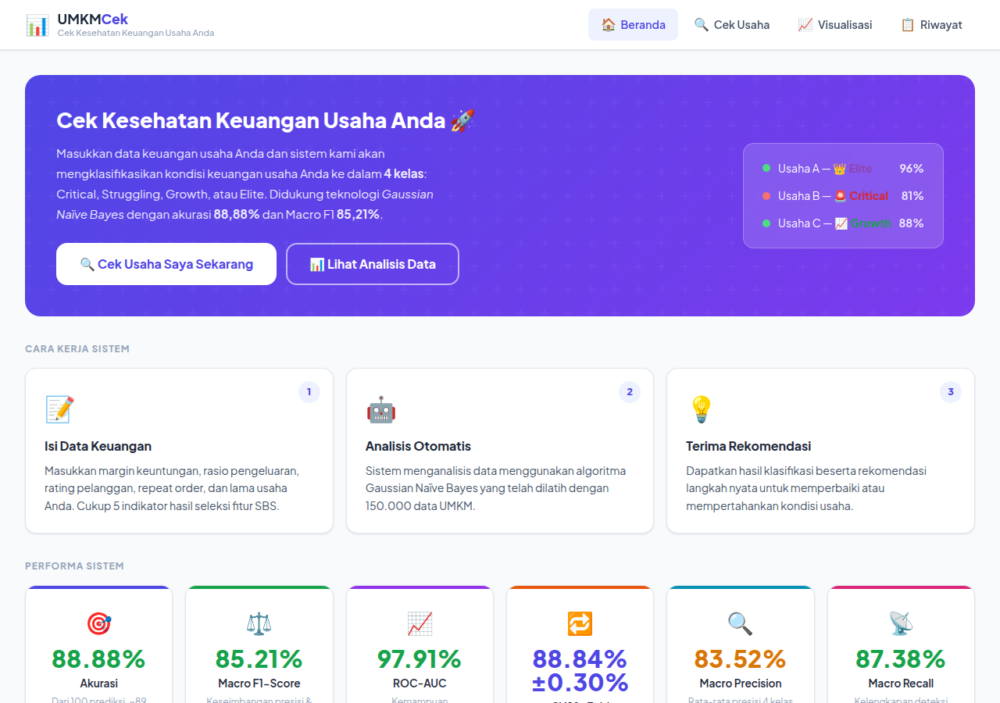
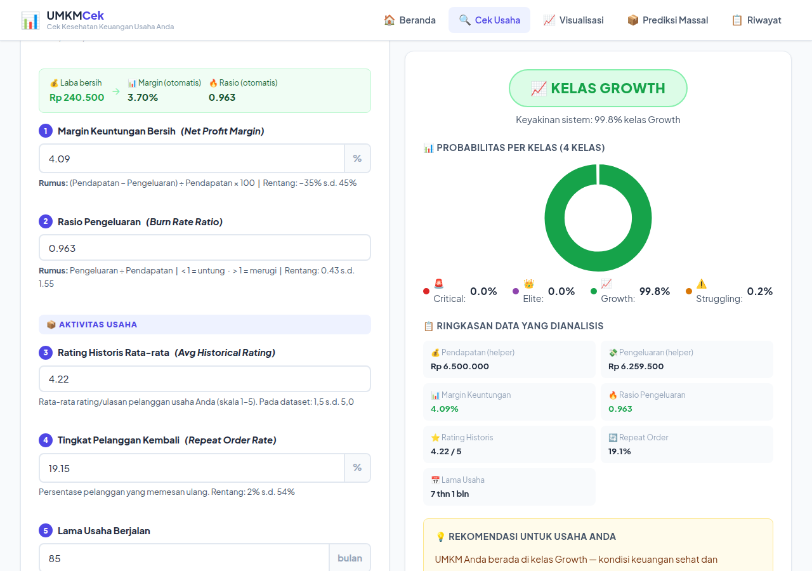
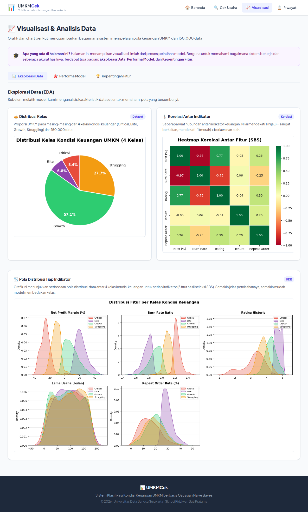

# UMKM Financial Health Classifier


Aplikasi web untuk mengklasifikasikan **kondisi keuangan UMKM ke dalam 4 kelas —
Critical, Struggling, Growth, dan Elite** — menggunakan **Gaussian Naïve Bayes**
dengan 5 fitur hasil seleksi *Sequential Backward Selection* (SBS).

## 🎓 Project Skripsi

Repository ini adalah **program dari skripsi (tugas akhir) penulis** — bukan project
sampingan. Seluruh isi repo ini (kode aplikasi, model, dataset, dan hasil evaluasi)
adalah implementasi dari penelitian skripsi berikut:

| | |
|---|---|
| **Judul Skripsi** | Penerapan Metode Naïve Bayes untuk Klasifikasi Kondisi Keuangan UMKM Berdasarkan Laporan Keuangan |
| **Penulis** | Ridzkyan Buti Pratama |
| **Program Studi** | Teknik Informatika (S1) |
| **Universitas** | Universitas Duta Bangsa Surakarta |
| **Tahun** | 2026 |

Aplikasi web di repo ini adalah prototipe yang dibangun dan dievaluasi di dalam
naskah skripsi tersebut, sehingga fitur dan hasil modelnya mengikuti persis
yang tertulis di laporan.



## Hasil Model (terverifikasi dari retrain)

Evaluasi pada test set 30.000 baris (split stratified 80/20, `random_state=42`):

| Metrik | Nilai |
|---|---|
| Accuracy | **0,8888** |
| Macro Precision | 0,8352 |
| Macro Recall | 0,8738 |
| Macro F1-Score | 0,8521 |
| Weighted F1-Score | 0,8905 |
| Macro ROC-AUC (One-vs-Rest) | **0,9791** |
| CV 10-Fold Accuracy | 88,84% ± 0,30% |
| CV 10-Fold Macro F1 | 85,17% ± 0,31% |

Per kelas:

| Kelas | Precision | Recall | F1 | Support | ROC-AUC |
|---|---|---|---|---|---|
| Critical | 0,8752 | 0,8766 | 0,8759 | 2.512 | 0,9820 |
| Elite | 0,6699 | 0,8204 | 0,7375 | 2.038 | 0,9847 |
| Growth | 0,9471 | 0,8884 | 0,9168 | 17.136 | 0,9714 |
| Struggling | 0,8488 | 0,9099 | 0,8783 | 8.314 | 0,9784 |

Confusion matrix diagonal (prediksi benar): Critical 2.202 · Elite 1.672 · Growth 15.224 · Struggling 7.565.
Kelas Elite paling sulit dipisahkan dari Growth (precision terendah) — keduanya sama-sama profil keuangan positif.

## 4 Kelas Kondisi Keuangan

| Kelas | Profil |
|---|---|
| 🚨 **Critical** | Tekanan keuangan serius: margin negatif, burn rate tinggi, rating & loyalitas rendah |
| ⚠️ **Struggling** | Keuangan perlu perhatian: margin tipis, pengeluaran mendekati/melebihi pendapatan |
| 📈 **Growth** | Sehat dan bertumbuh: margin positif, burn rate terkendali, pelanggan loyal |
| 👑 **Elite** | Sangat kuat: margin tinggi, rating pelanggan tinggi, repeat order tinggi |

## Seleksi Fitur — Sequential Backward Selection

Dataset awal memiliki **11 kandidat fitur numerik**. SBS mengeliminasi fitur satu per satu
(yang kontribusinya paling kecil) hingga tersisa **5 fitur optimal**:

✅ **Terpilih:** Net Profit Margin (%), Burn Rate Ratio, Avg Historical Rating,
Business Tenure (bulan), Repeat Order Rate (%)

❌ **Tereliminasi:** Monthly Revenue, Transaction Count, Review Volatility,
Digital Adoption Score, Location Competitiveness, Sentiment Score

Temuan menariknya: besar omzet (*Monthly Revenue*) dan jumlah transaksi ternyata
**tidak** menentukan kondisi keuangan UMKM — efisiensi (margin & burn rate),
kepuasan pelanggan (rating), loyalitas (repeat order), dan pengalaman usaha (tenure) yang menentukan.

## Screenshot

| Dashboard | Klasifikasi |
|---|---|
|  |  |

| Visualisasi |
|---|
|  |

## Cara Menjalankan

```bash
# 1. Masuk folder aplikasi
cd umkm-financial-classifier

# 2. Install dependensi
pip install -r requirements.txt

# 3. Siapkan dataset di data/raw/dataset_umkm.csv
#    (unduh dari Kaggle: zkyfauzi/umkm-dataset — lihat catatan dataset di bawah)

# 4. Training model (sekali)
python train.py

# 5. Jalankan aplikasi
python app.py
# → Buka http://localhost:5000
```

Menjalankan test:

```bash
cd umkm-financial-classifier
pytest tests/ -v     # 50 tests: unit + property-based (Hypothesis)
```

## Struktur Repo

```
.
├── README.md                  # ← Anda di sini
├── LICENSE
├── docs/screenshots/          # Screenshot aplikasi
└── umkm-financial-classifier/ # Aplikasi Flask
    ├── app.py                 # Entry point + REST API
    ├── train.py               # Training pipeline
    ├── requirements.txt
    ├── src/                   # preprocessing, model, evaluation, visualization
    ├── templates/ + static/   # UI: Dashboard, Klasifikasi, Visualisasi, Riwayat
    ├── models/                # gnb_pipeline.pkl + metrics.json (hasil training)
    ├── data/raw/              # dataset_umkm.csv (150.000 baris, disertakan di repo)
    └── tests/                 # Unit & property-based tests
```

## Fitur Aplikasi

- **Dashboard** — metrik model (macro/weighted) & profil per kelas
- **Klasifikasi** — form 5 fitur SBS, hasil 4 kelas + probabilitas per kelas + rekomendasi per kelas
- **Visualisasi** — distribusi kelas, korelasi, KDE per kelas, confusion matrix 4×4, ROC One-vs-Rest, feature importance, skor CV
- **Riwayat & Tren Tahunan** — log prediksi, filter per kelas, tren probabilitas positif per bulan

## Catatan Jujur tentang Dataset

Dataset bersifat **sintetis** (dibangkitkan secara artifisial, bukan data UMKM riil),
bersumber dari Kaggle: **[zkyfauzi/umkm-dataset](https://www.kaggle.com/datasets/zkyfauzi/umkm-dataset)**
(150.000 baris). Konsekuensinya:

- Metrik tinggi (akurasi 88,9%, ROC-AUC 0,979) mencerminkan pola pada data sintetis;
  performa pada data UMKM riil kemungkinan lebih rendah dan perlu validasi lanjutan.
- File dataset (±20 MB) **disertakan di repo ini** di
  `umkm-financial-classifier/data/raw/dataset_umkm.csv` agar hasil penelitian
  dapat direproduksi persis; salinan aslinya juga tersedia di Kaggle pada tautan di atas.
  Format input klasifikasi mengikuti 5 fitur hasil SBS pada tabel di atas.

## Penulis

**Ridzkyan Buti Pratama** — S.Kom, Teknik Informatika, Universitas Duta Bangsa Surakarta (2026)

- Portfolio: [kian.my.id](https://kian.my.id)
- LinkedIn: [linkedin.com/in/ridzkyanbutipratama](https://www.linkedin.com/in/ridzkyanbutipratama)
- GitHub: [@kianlabs](https://github.com/kianlabs)

## Lisensi

MIT — © 2026 Ridzkyan Buti Pratama
